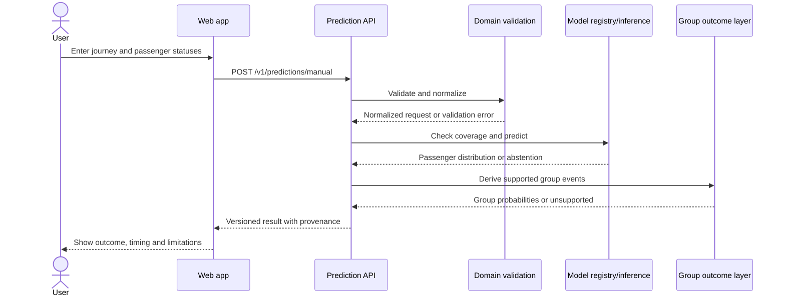
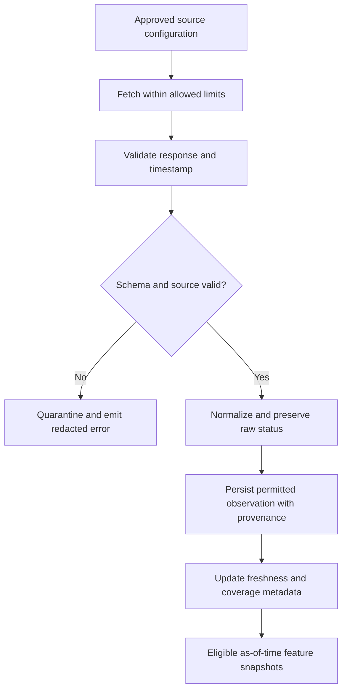

# System design

Status: proposed design. The repository does not yet contain the running system described here.

## Goals

- Keep the user-facing experience independent of provider-specific railway integrations.
- Keep probabilistic inference separate from data ingestion and training.
- Preserve the evidence and target semantics behind each result.
- Support one passenger and mixed-status groups without changing the data model.
- Fail safely when coverage, source freshness or model availability is insufficient.

## Logical boundaries

### Web application
Responsible for form state, input help, validation feedback, passenger rows, report presentation and saved prediction navigation. It must not contain provider secrets, model weights or the core probability calculations.

### Public API
Validates request shape, applies domain parsing, authorizes access to saved/tracking resources, resolves supported prediction behavior, and returns versioned responses. It should not own long-running model training.

### Domain package
Defines canonical statuses, quotas/classes as source-supported vocabularies, position parsing, outcome definitions and invariant checks. Raw input must be retained alongside normalized values where storage is permitted.

### Source adapters
Encapsulate an approved data provider's authentication, request/response mapping, rate limits, timeouts, retries, freshness and error semantics. Provider-specific schemas must not leak into the core domain model.

### Observation store
Stores permitted, time-stamped status observations and source provenance. It must separate raw provider identifiers from public internal IDs and apply retention rules.

### Feature builder
Creates an immutable feature snapshot as of `prediction_at`. It must never read later status observations, later published events, the final outcome, or transformations informed by target values.

### Model registry and inference
Resolves an evaluated model version, checks coverage, runs inference and applies the validated calibration layer. A model without an evaluation record or compatible feature schema must not be used for normal user-facing forecasts.

### Group outcome layer
Turns model output into group-event estimates while accounting for dependencies. A future implementation may use a joint model, structured conditional model, or simulation from a validated joint distribution; the choice requires empirical comparison.

### Research pipeline
Imports approved datasets, validates schemas, constructs snapshots, creates chronological splits, trains candidates, calibrates probabilities and produces reproducible reports. It should run separately from web requests.

## Prediction request sequence

## Data ingestion sequence

## State and consistency

- A status observation is append-only once accepted; corrections should be represented as a new version or explicit correction event.
- A prediction is immutable as a record of what the model returned at that time.
- A later prediction references the later input snapshot and model version; it does not overwrite the earlier prediction.
- Provider outage does not remove the last known observation but marks it stale.
- Model and feature-schema versions must be compatible.
- Training data, evaluation outputs and public inference artifacts have different access requirements.

## Deployment boundaries

The public web client, API, worker and training environment are separate logical roles even if the first deployment combines some of them. Provider credentials remain server-side. Training should not load identifiable source data into notebooks without the required permissions and access controls.

## Scaling principles

Start with a modular application, a single relational database and a simple job mechanism where feasible. Add message queues, model-serving infrastructure or caching only after measured traffic, latency or reliability requirements justify the added operational cost.
